# Job Agent

**An AI job-search assistant that does the busywork and leaves the decisions to you.** It finds jobs that match your criteria, writes a tailored CV and cover letter from facts you've confirmed, and prefills the application form. Then it stops and waits for you.


> **Status: MVP in active development.** Search, Craft, Review and Prefill work end to end (prefill for Lever and Greenhouse forms so far). Reply tracking via Gmail has started. Hosting, auth and the portfolio material are in progress: see [Roadmap](#roadmap).

---

## Contents

- [What problem does it solve?](#what-problem-does-it-solve)
- [What does it look like?](#what-does-it-look-like)
- [What can you try?](#what-can-you-try)
- [What's technically interesting?](#whats-technically-interesting)
- [Architecture](#architecture)
- [Roadmap](#roadmap)
- [Project layout](#project-layout)
- [Documentation](#documentation)

---

## What problem does it solve?

A good job application is slow to make. You find postings that actually meet your criteria, rewrite your CV and cover letter for each one, and type the same ten answers into every form. Fully automated "apply bots" are fast but careless: they invent experience, guess salaries, apply twice, and can be steered by text hidden in a job page.

Job Agent sits in between. **Agents do the legwork, and you make every decision that matters.**

| Without it | With Job Agent |
|---|---|
| Browse many job boards by hand | **Search** finds companies that fit your preferences, checks their Greenhouse / Lever / Ashby boards and Gmail job alerts, and scores each posting against your criteria |
| Rewrite your CV for every role | **Craft** writes a CV and cover letter from your confirmed Profile only. Every claim cites the fact it came from |
| Retype the same answers in every form | **Apply** opens the form in a visible browser and fills it from your Profile and saved answers. You review it and click Submit yourself |
| Track replies in a spreadsheet | **Check replies** reads Gmail and moves cards to *Replied* or *Rejected* |

The ground rules (from [docs/PRODUCT.md](docs/PRODUCT.md)):

1. **You approve between every stage.** Shortlist, Approve and Submit are always your clicks.
2. **Ask, don't guess.** When an agent can't answer a question, it raises a *Blocker* and waits. Your answer is saved so you're never asked twice.
3. **Verified facts only.** No invented experience, and a missing salary is written as "not stated", never estimated.
4. **Evidence for everything.** Documents are versioned and hashed; each submission keeps a screenshot and the confirmation text.

## What does it look like?

<!-- TODO (Week 4): replace with real screenshots in docs/images/ and a link to the demo video. -->
> 📸 Screenshots and a 2-minute demo video are coming in Week 4 (see [Roadmap](#roadmap)).

The app is a **Kanban board**. Each job is a card that moves through fixed columns, and only the green steps are done by an agent:

```mermaid
flowchart LR
    S([Search]):::agent --> F[Found]
    F -->|you: Shortlist| SL[Shortlisted]
    SL -->|you: Craft, agent writes| C[Crafted]
    C -->|you: review & Approve| A[Approved]
    A -->|agent: Prefill form| R{{Ready to submit}}
    R -->|you: Submit & Mark applied| AP[Applied]
    AP -->|agent: Check replies| RE[Replied / Interview / Rejected]
    classDef agent fill:#d1fae5,stroke:#059669
```



The main screens:

- **Setup**: a four-step checklist. Connect Claude, then build your Profile (upload a PDF or DOCX CV and Claude extracts it, or type it in), then set what you're looking for, then answer the common application questions.
- **Board**: the columns above, updated live while agents work. Each card shows its score, the reasons for it, the salary as stated, and its current run with a Stop button.
- **Craft modal**: the generated CV and cover letter side by side with the PDF preview. While Claude writes, click **Run in background** and keep working. When it's done, the card is in Crafted. There you can edit, ask Claude again, and **Approve**, which saves your edits and moves the card to Approved.
- **Questions**: your saved answers (the AnswerBank) and an inbox of open Blockers.
- **Settings**: Claude provider, Gmail connection, and export or delete all data.

## What can you try?

### Run it locally (about 5 minutes)

Requires **Node 22+**, **pnpm 10** and **Docker**.

```bash
git clone https://github.com/Lilychili/job-agent.git
cd job-agent
cp .env.example .env
pnpm install
pnpm --filter @jobagent/agents exec playwright install chromium   # renders the CV and cover letter PDFs
pnpm db:up        # Postgres 16 on 127.0.0.1:5432 (also creates jobagent_test)
pnpm db:migrate
pnpm db:seed      # optional: a demo Profile and Preferences, so you can skip onboarding
pnpm dev          # web on http://127.0.0.1:3000 plus the worker
```

Agents reach Claude in one of two ways, chosen in **Settings**:

- your signed-in **Claude Code CLI** (uses your subscription), or
- an **Anthropic API key** (pay per use). First put a 32-byte key in `.env` as `APP_ENCRYPTION_KEY`, then restart `pnpm dev`:

  ```bash
  node -e "console.log(require('crypto').randomBytes(32).toString('base64'))"
  ```

Gmail (job alerts and replies) is optional. See [docs/SOURCES.md](docs/SOURCES.md) for the OAuth setup.

### A guided tour

Open http://127.0.0.1:3000/setup. If you ran `pnpm db:seed`, go straight to the board.

1. **Search**: new jobs appear in *Found*, each with a score and reasons. Search again and you get no duplicates.
2. **Shortlist → Craft**: the editor opens while Claude writes the CV and cover letter. Watch, or click **Run in background** and carry on. When the draft is ready, the card moves to *Crafted* on its own.
3. **Review → Approve**: open a Crafted card with **Review draft** and edit next to the live PDF preview. **Approve**, in the editor or straight from the card, saves your edits, locks the exact document versions by hash and moves the card to *Approved*. The Shipper then finds the job's application form.
4. **Apply**: a real browser window opens and fills the form (Lever and Greenhouse today). A required question it can't answer becomes a red **Blocker** instead of a guess.
5. **Answer the Blocker**: the answer is saved and the form is refilled from scratch. Review it, then submit it yourself in that window.
6. **Mark applied**: a screenshot and the confirmation text are kept as evidence, and the job can never be applied to again.
7. **Check replies** (with Gmail connected): employers' answers move cards to *Replied* or *Rejected*.

> 🔒 The app has no login yet and **only accepts requests from your own machine** (`apps/web/proxy.ts`). Open it at `127.0.0.1` or `localhost`, not through a tunnel or a LAN address.

### Run the checks

```bash
pnpm test        # unit tests plus DB tests for every state-machine guard
pnpm typecheck
pnpm lint
```

The DB tests connect through `TEST_DATABASE_URL`. Each test file runs in a database of its own, copied from a migrated template, and dropped when the file ends. So files run in parallel, and test runs from other checkouts on the same Postgres don't collide. CI runs all of this on every pull request ([ci.yml](.github/workflows/ci.yml)).

## What's technically interesting?

**1. There's exactly one way to change a card.** `transition(applicationId, action)` in [`packages/core`](packages/core/src/transition.ts) is the only code that moves a job between columns. In **one database transaction** it locks the row, checks that the move is legal against a declarative transition table ([`machine.ts`](packages/core/src/machine.ts)), runs the guards, creates the agent run, **enqueues the background job in the same transaction**, writes an audit event, and sends a `NOTIFY`. If any step fails, nothing happens, including the queue write.

**2. Safety rules live in code, not prompts.** The database refuses illegal states even if an LLM misbehaves:

- No Craft before you've confirmed your Profile.
- Approved PDFs must match their stored SHA-256 right before upload, and a DB trigger makes approved documents immutable.
- A partial unique index allows only one active run per application.
- No Shipper run once submission evidence exists, so the same job can't be applied to twice.
- The form-filling session blocks the ATS's submit request and any navigation off the job's ATS host.

**3. Prompt injection is treated as a given.** Job postings and application pages are attacker-controlled text. That text is wrapped as untrusted data, each agent role gets an explicit, minimal tool allowlist, and the form filler may only use values from your Profile, your AnswerBank or approved documents. Every filled value records which of those it came from. See [docs/SECURITY.md](docs/SECURITY.md).

**4. No Redis, no WebSocket server: Postgres does it all.** [pg-boss](https://github.com/timgit/pg-boss) provides the job queue, and `LISTEN/NOTIFY` streamed over **Server-Sent Events** provides live updates. Notifications sent inside a transaction arrive only on commit, so the board never shows a change that was rolled back.

**5. Background jobs are built to fail safely.**

- **Idempotent:** the run id is the queue job id, and a worker only starts a run it can move from `queued` to `running`, so a duplicate delivery is skipped.
- **Time limits:** every queue has a limit, enforced with an `AbortSignal`.
- **Crash recovery:** a heartbeat fails stale runs, and a failure rolls the card back to its previous column.
- **Stop button:** long runs can be cancelled.

**6. Grounded generation.** Pen (the CV and cover letter writer) must cite a Profile fact for every claim, and a validator rejects uncited claims before anything is rendered. PDFs are rendered with Playwright, their metadata is stripped, and each version is hashed.

**7. Two ways to reach Claude.** The same structured-output wrapper (Zod-validated, with one repair retry and real token usage logged per run) runs either against the Anthropic API or through the user's Claude Code CLI in a locked-down, tool-less sandbox.

## Architecture

```mermaid
flowchart LR
    subgraph Browser
        UI[Board UI]
    end
    subgraph Web["apps/web (Next.js)"]
        API[API routes] --> T["transition()"]
        SSE["/api/events (SSE)"]
    end
    subgraph PG[(Postgres 16)]
        D[(data)]
        Q[(pg-boss queue)]
        N{{LISTEN / NOTIFY}}
    end
    subgraph Worker["apps/worker (Node)"]
        J[Scout · Pen · Shipper · Replies]
    end
    UI -->|fetch| API
    T -->|one transaction| D & Q
    Q --> J
    J -->|results| D
    J --> N
    T --> N
    N --> SSE -->|live updates| UI
    J -->|structured output| C[Claude]
    J -->|Playwright| ATS[Greenhouse · Lever · Ashby]
```

More detail is in [docs/ARCHITECTURE.md](docs/ARCHITECTURE.md), [docs/STATE_MACHINE.md](docs/STATE_MACHINE.md) and [docs/DATA_MODEL.md](docs/DATA_MODEL.md).

**Stack:** TypeScript · Next.js (App Router) · React · Postgres 16 · Drizzle ORM · pg-boss · Playwright · Zod · Vitest · Claude (Anthropic API / Claude Code) · pnpm workspaces · GitHub Actions

## Roadmap

✅ Done · 🚧 In progress · ⏳ Planned. The full plan is in [docs/ROADMAP.md](docs/ROADMAP.md), and **how each item will be built** is in [docs/DEPLOYMENT_PLAN.md](docs/DEPLOYMENT_PLAN.md).

| Milestone | Status |
|---|---|
| M0 Foundations: monorepo, state machine, queue, live board | ✅ |
| M1 Onboarding: Profile, CV extraction, Preferences, AnswerBank, encrypted key | ✅ |
| M2 Search: ATS clients, dedupe, scoring, Gmail job alerts | ✅ |
| M3 Craft and review: cited CV and cover letter, PDF, approve and lock | ✅ (exit check with real jobs pending) |
| M4 Apply v1: prefill and human submit | 🚧 Lever and Greenhouse done; Ashby adapter next |
| M6 Reply tracking via Gmail | 🚧 Manual check works; scheduling and domain matching next |

**Week 3: Deployment** 🚧

- [ ] Authentication (single owner, replacing the localhost-only guard)
- [ ] Hosted PostgreSQL
- [ ] Worker deployed separately from the web app
- [ ] Persistent file storage for CVs, PDFs and evidence (object storage)
- [ ] Monitoring: errors, health checks, worker heartbeat, cost per run

**Week 4: Portfolio** ⏳

- [ ] Demo video
- [ ] Architecture diagram
- [ ] Engineering case study
- [ ] Polish this README and the GitHub profile

**Later:** auto-submit with idempotency keys (M5), more ATS sources, analytics on response rate by template version.

## Project layout

```
apps/web          Next.js board, API routes, SSE endpoint
apps/worker       pg-boss consumers: extractor, scout, pen, shipper, replies
packages/core     State machine, transition(), guards, runs, AnswerBank, Gmail, secrets
packages/db       Drizzle schema, migrations, NOTIFY helper
packages/queue    pg-boss setup and per-queue time limits
packages/ats      Greenhouse, Lever and Ashby clients and form finding (plain HTTP, no LLM)
packages/agents   Claude client, prompts, structured outputs, PDF rendering
packages/forms    Playwright form filling: FormSession safety rules, per-ATS adapters
agents/           Versioned prompt files per agent role, plus shared security rules
docs/             Product, architecture and design notes
```

## Documentation

| Doc | What's in it |
|---|---|
| [PRODUCT.md](docs/PRODUCT.md) | Problem, principles, success metrics |
| [MVP_SCOPE.md](docs/MVP_SCOPE.md) | What's in and out of the MVP, user stories |
| [ARCHITECTURE.md](docs/ARCHITECTURE.md) | Stack, processes, Claude integration, job design |
| [STATE_MACHINE.md](docs/STATE_MACHINE.md) | Every status, action and guard |
| [DATA_MODEL.md](docs/DATA_MODEL.md) | Tables and invariants |
| [AGENTS.md](docs/AGENTS.md) | Each agent role, its inputs, outputs and tools |
| [SECURITY.md](docs/SECURITY.md) | Prompt injection, secrets, documents, personal data |
| [SOURCES.md](docs/SOURCES.md) | Where jobs come from; Gmail setup |
| [RISKS.md](docs/RISKS.md) | Known risks and mitigations |
| [DEVELOPMENT_NOTES.md](docs/DEVELOPMENT_NOTES.md) | Deviations from the plan, implementation notes |
| [DEPLOYMENT_PLAN.md](docs/DEPLOYMENT_PLAN.md) | How Weeks 3 and 4 will be built |

---

Built by [Liliya Gitin](https://github.com/Lilychili). Single-user and self-hosted: your data stays in your own Postgres database and `DATA_DIR`.
