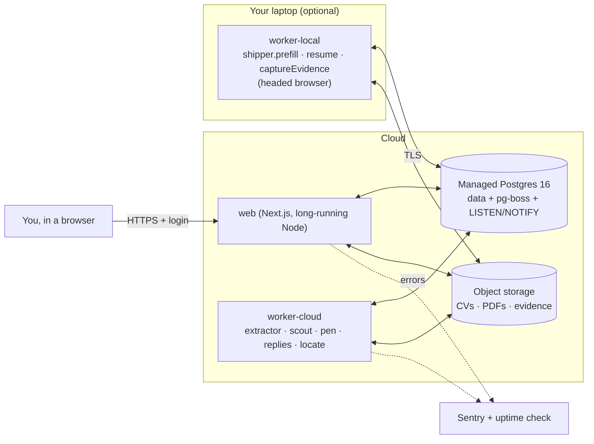

# Deployment and portfolio plan (Weeks 3–4)

How to take Job Agent from "runs on my laptop" to "runs in the cloud and is presentable", without breaking the safety properties the MVP was built on.

Each section has the same shape: **what's true in the code today → the decision → the steps → how you know it's done.** Recommendations are for a single-user app on a small budget. Where several vendors would work, the requirement comes first and the vendor second, so you can swap.

---

## 0. Read this first: three facts that shape everything

The current code assumes **one machine**. Three places depend on that, and each one decides part of the plan.

| Assumption | Where | Consequence for deployment |
|---|---|---|
| Web and worker share a disk | `apps/web/app/api/profile/extract/route.ts` writes the CV to `DATA_DIR`; `apps/worker/src/jobs/extractor.ts` reads it. Pen writes PDFs and the Shipper writes screenshots that the web app serves (`documents/[id]/pdf`, `evidence/[id]`) | Once they're separate services they no longer share a disk, so **files must move to object storage** (§4) |
| Nobody but the owner can reach the app | `apps/web/proxy.ts` rejects any request whose `Host`/`Origin` isn't localhost | Once hosted, **every request is refused**. Localhost-only must be replaced by real authentication (§1) |
| The Shipper fills forms in a **visible** browser on the owner's screen, and the owner clicks Submit | `packages/forms/src/session.ts` (`headless: false`) | A cloud server has no screen for you to look at. **The Shipper has to stay on your machine, or move to a remote browser** (§3) |

There is also a fourth, smaller one: the **Claude Code CLI provider** uses your signed-in subscription on your machine. In the cloud, use the **Anthropic API key** provider; it already exists and is encrypted at rest.

### Target architecture



Because pg-boss is just Postgres, **"separate worker deployment" mostly means choosing which queues each worker process subscribes to.** That's the one idea that makes this whole plan small.

### Order of work

Do the steps in this order. Each step leaves the app working locally, so you never have a broken main branch.

1. **Config and health:** env validation, `/api/health`, structured logs (part of §5). Small, and it makes everything after easier to debug.
2. **Storage abstraction** (§4), first with a local-disk implementation, so nothing changes yet.
3. **Worker roles** (§3): one worker image that can run all queues or a subset.
4. **Authentication** (§1).
5. **Hosted Postgres** (§2), then deploy web and worker-cloud.
6. **Monitoring** (§5).
7. **Week 4:** portfolio material (§6–§9).

---

## 1. Authentication

**Today:** no login. `proxy.ts` + `packages/core/src/origin.ts` allow only same-machine requests. This also protects against DNS rebinding and cross-site writes (CSRF). **Don't lose that second half.**

**Goal:** exactly one person (you) can use the hosted app. There's no sign-up and no multi-tenancy.

### Options

| Option | Effort | Pros | Cons |
|---|---|---|---|
| **A. Auth.js (NextAuth) with a GitHub or Google provider, plus an email allowlist** ✅ *recommended* | ~1 day | Real login in the app, which is portfolio-worthy; no passwords stored; the session is available in every route handler | You add a few tables or JWT config |
| B. An identity-aware proxy in front (Cloudflare Access, Tailscale Funnel/Serve, an oauth2-proxy sidecar) | ~2 hours | Zero app code; very strong | The app itself still has no notion of a user; harder to show in a case study |
| C. Your own password + session cookie | ~1 day | No third party | You own password hashing, reset, rate limiting. Not worth it for one user |

### Steps (option A)

1. Add Auth.js to `apps/web`, with one OAuth provider. Use **database or encrypted-JWT sessions**, a cookie that is `HttpOnly`, `Secure` and `SameSite=Lax`, and a short-ish lifetime (for example 7 days).
2. **Allowlist:** in the `signIn` callback, accept only `OWNER_EMAIL` from env (verified email only). Every other account is refused before a session is created.
3. **Rewrite `proxy.ts` as a two-mode guard:**
   - `AUTH_MODE=local` (default, today's behaviour): keep `isLocalRequest()` exactly as is, so local development needs no login.
   - `AUTH_MODE=oauth`: require a valid session on every page and `/api/*` route except `/api/auth/*` and `/api/health`.
   - **In both modes**, keep the cross-site write check (`Origin` / `Sec-Fetch-Site`), but compare against `APP_URL` instead of localhost. That's your CSRF protection for `POST`/`DELETE`.
4. **SSE (`/api/events`)** must check the session too. EventSource sends cookies on same-origin requests, so no extra token is needed.
5. Keep the existing frame-ancestors / `X-Frame-Options` protection, and add `Strict-Transport-Security` in production.
6. **Gmail OAuth:** add the production callback `https://<your-domain>/api/gmail/callback` to the Google client, and keep the local one for development.
7. **Tests:** unit-test the guard as a pure function, like `origin.test.ts` does today. Cover: no session gives 401 or a redirect; the wrong email is refused; a cross-site POST gets 403 even with a session; `/api/health` stays public.

**Done when:** in production, a logged-out `curl` of `/api/board` returns 401, a different Google/GitHub account can't log in, and `pnpm dev` locally still works with no login.

> **Rule of thumb:** authentication answers *who*; the existing origin check answers *from where*. You need both.

---

## 2. PostgreSQL hosting

**Today:** Postgres 16 in Docker. The app depends on three Postgres features, so **check that the provider supports them before you choose one:**

| Needs | Why | Gotcha |
|---|---|---|
| **Long-lived session connections** | The web app holds one `LISTEN app_events` connection for SSE; the worker holds one for Stop and Show form; pg-boss polls | **Transaction-mode poolers (PgBouncer, Supavisor in transaction mode, Neon's `-pooler` host) break `LISTEN`.** Use the **direct / session** connection string for the listener and pg-boss |
| Triggers, partial unique indexes | Guards (immutable approved documents, one active run) | Supported everywhere; just make sure migrations run |
| `gen_random_uuid()` | IDs | Built into PG 13+ |

### Recommendation

Use a **managed Postgres 16+ with a direct connection string, daily backups and point-in-time recovery**, in the same region as the web and worker. Any of these fit: Neon, Supabase, Railway, Render, Fly Managed Postgres, AWS RDS. Choose the one that sits next to where you host the web app (§3).

### Steps

1. **Two URLs in env:** `DATABASE_URL` (direct, used for `LISTEN` and pg-boss) and optionally `DATABASE_POOL_URL` (pooled, for ordinary queries if you ever need many connections). For one user, a single direct URL is fine. Don't over-engineer.
2. **Use TLS:** `?sslmode=require` (or `verify-full` with the CA certificate). Check that `createPool` in `packages/db` passes the SSL setting through.
3. **Pool size:** keep it small (5–10 per process). Free tiers often cap total connections around 20–100, and you'll have web + worker-cloud + maybe worker-local.
4. **Migrations as a release step**, not at boot: run `pnpm db:migrate` once per deploy (a "release command" or a CI job) *before* the new web and worker start. Never let two processes race to migrate.
5. **Use a separate database for tests.** CI already uses a service container. Never point `TEST_DATABASE_URL` at production: the DB tests truncate it.
6. **Backups:** turn on PITR and **do one restore drill** into a scratch database. A backup you've never restored is only a hope. Write the steps into this doc.
7. **Least privilege (nice to have):** the app role owns no superuser rights; the migration role is separate.

**Done when:** the hosted DB passes `pnpm db:migrate`, the board's live updates arrive (which proves `LISTEN` works through your connection string), and you've restored a backup once.

---

## 3. Separate worker deployment

**Today:** `apps/worker/src/index.ts` subscribes to **every** queue in one process. That's correct for a laptop. For the cloud, split by what a job *needs*:

| Queue | Needs | Runs where |
|---|---|---|
| `extractor.extract`, `scout.search`, `scout.rescore`, `pen.craft`, `replies.check`, `shipper.locate` | Network, Claude API, headless Chromium (Pen renders PDFs; locate uses HTTP) | **worker-cloud** |
| `shipper.prefill`, `shipper.resume`, `shipper.captureEvidence` | A **headed** browser that *you* look at and submit from | **worker-local** (your laptop), or later a remote browser |
| `heartbeat` | Exactly one scheduler | worker-cloud |

### Steps

1. **Add `WORKER_QUEUES`** (comma-separated, default `*`). Register `boss.work()` only for the queues listed. Today's behaviour is the default, so nothing changes locally.
2. **Fix the hidden single-worker assumptions.** These would silently break with two workers:
   - `failStaleRuns(..., { assumeNoneRunning: true })` at startup fails **all** running runs. With two workers, restarting the cloud worker would kill the Shipper run on your laptop. **Scope it to the queues this worker owns.**
   - `update application set form_window_open = false` at startup belongs only to the worker that owns the Shipper queues.
   - `settings.worker_last_seen_at` is a single value. Replace it with a `worker_heartbeat(worker_id, queues, last_seen_at)` table. The board can then say "cloud worker ✓ · local Shipper ✗", and `failRunsWithoutWorker` can check whether the worker for *that* queue is alive.
   - The `show_form` listener should only act in the worker that owns the Shipper queues.
3. **Containerize.** Write one `Dockerfile` with two targets:
   - `web`: `next build` with `output: "standalone"`, running `next start -H 0.0.0.0` (today it binds to 127.0.0.1 for safety; in the container, auth replaces that).
   - `worker`: based on the official Playwright image pinned to the **same version as `playwright` in package.json**, so Chromium is there for PDF rendering. Use `tini` or `--init` so `SIGTERM` reaches the graceful shutdown already in `index.ts`.
4. **Hosting.** The web app needs a **long-running Node process**, because SSE and the `LISTEN` connection live for the whole session. Serverless platforms with short function limits are a poor fit. A container platform fits: Fly.io, Railway, Render, Cloud Run with min-instances 1 and a long request timeout, or a small VPS with Docker Compose.
5. **Scaling:** run **one** worker-cloud replica. pg-boss is safe with more, but you don't need them, and one keeps the logs simple.
6. **Shutdown:** set the platform's stop timeout to at least 30 s; the worker already stops pg-boss gracefully (15 s).
7. **worker-local** is the same code: `WORKER_QUEUES=shipper.prefill,shipper.resume,shipper.captureEvidence DATABASE_URL=<hosted> pnpm dev:worker`. It connects *out* to the hosted DB, so you open no ports on your laptop.

> **Later, for a fully hosted Shipper:** run headed Chromium in the cloud and stream it to you with noVNC, or use a hosted browser service over CDP. Treat it as M5-era work: it changes the security story (whose IP, whose cookies), so write an ADR first.

**Done when:** with the laptop closed, Search, Craft and Check replies work from your phone; with worker-local running, Apply opens the form on your laptop; and restarting one worker never fails the other's runs.

---

## 4. Persistent file storage

**Today:** `DATA_DIR` on local disk holds `cv/`, the document PDFs and the evidence screenshots. Paths stored in the DB are **relative**, resolved by `resolveDataPath()`, which also blocks path escapes. That's a good starting point.

**Decision:** S3-compatible **object storage** (Cloudflare R2, AWS S3, Backblaze B2, Supabase Storage, or MinIO locally), behind a small interface. Container disks are temporary, and a shared volume can't be mounted by two services on most platforms.

### Steps

1. **Add a `FileStore` interface in `packages/core`:**
   ```ts
   interface FileStore {
     put(key: string, body: Buffer, contentType: string): Promise<void>;
     get(key: string): Promise<Buffer | null>;
     delete(prefix: string): Promise<void>;   // for "Delete all data"
   }
   ```
   with `LocalFileStore` (today's behaviour, using `resolveDataPath`) and `S3FileStore`. Choose between them with `STORAGE=local|s3`. **Keep the DB values as keys** (`cv/…`, `documents/…`), so no data migration is needed.
2. **Replace each direct `fs` call** with the store. The call sites are known:
   - `api/profile/extract/route.ts` (write the CV) and `jobs/extractor.ts` (read it)
   - `packages/agents/src/documents.ts` (write PDFs) and `api/documents/[id]/pdf/route.ts` (serve them)
   - `packages/core/src/guards.ts` (hash check) and `packages/forms/src/session.ts` (re-hash before upload): download, hash, and upload from a temp file
   - Evidence screenshots: written by the Shipper, served by `api/evidence/[id]/route.ts`
   - `api/data/delete`: delete everything under the prefixes
3. **The SHA-256 guard still holds:** compute the hash on the bytes you `get()`, exactly as now. Object storage is not trusted any more than the disk was.
4. **Keep the bucket private.** Keep streaming files **through the authenticated API routes** as today; only switch to short-lived presigned URLs if you need to serve large files. Turn on server-side encryption; these files hold your CV and personal data.
5. **Consider versioning** on the bucket: it costs little and protects the "approved documents are immutable" promise against accidental overwrites.
6. **Local development:** keep `STORAGE=local` by default. Optionally add MinIO to `docker-compose.yml` to test the S3 path.
7. **Tests:** run the same contract test suite against `LocalFileStore` and a MinIO-backed `S3FileStore` in CI.

**Done when:** you redeploy both services (new containers, empty disks), and every PDF and screenshot still opens and every hash check still passes.

---

## 5. Monitoring

For one user, monitoring means **"I find out something's broken before I need it, and I can see why."** Four layers, cheapest first:

| Layer | What | How |
|---|---|---|
| **Health** | Is the web app up? Are the workers alive? | Add `GET /api/health` (public, no data): DB `select 1`, plus the freshest `worker_heartbeat` row per role. Return 503 if the cloud worker is silent for more than 3 min. Point a free **uptime monitor** (Better Stack, UptimeRobot, or the platform's own) at it, with alerts by email or phone |
| **Errors** | Exceptions with stack traces | **Sentry** (free tier) in web (`@sentry/nextjs`) and worker (`@sentry/node`). Tag events with `runId`, `queue`, `applicationId`. **Scrub PII:** no CV text, answers or email bodies in breadcrumbs (`beforeSend`) |
| **Logs** | What happened, in order | Swap `console.*` for **structured JSON logs** (pino) with `runId` / `queue` on every line. The platform collects stdout. Redact keys matching `/key|token|secret|authorization/i`, which matches the rule already in SECURITY.md |
| **Business metrics** | Is the product working? What does it cost? | **You already have the data:** `agent_run` stores status, duration and real token usage. Add an **Ops** page (or a SQL view) showing runs per day by status, failure rate per queue, p95 duration, and tokens and cost per application. That last one is an MVP success metric in PRODUCT.md |

Alerts worth having (and no more, to avoid alert fatigue):

1. Health check failing for more than 5 min.
2. A new Sentry issue (first occurrence).
3. More than 3 failed runs in an hour on the same queue (a cron query or a Sentry metric alert).

**Done when:** you kill the cloud worker on purpose and get an alert within 5 minutes, and an error thrown in a job shows up in Sentry with its `runId`.

---

## 6. Demo video (Week 4)

**Goal:** 2–3 minutes that a recruiter will actually watch, and an engineer will respect.

**Before recording:**

- Use **seeded demo data only** (`pnpm db:seed`, or a fictional Profile). **Never show your real CV, email or answers.** Check the Gmail panel, the Settings key (`…last4`) and the browser's address bar.
- Use a clean browser profile, a hidden bookmarks bar, 1080p, 100–125% zoom, and turn off notifications.
- Pre-warm everything: run Search once so the board isn't empty, and have a Craft ready. Live LLM latency makes a dull video, so **cut the waits** in editing and note "(sped up)".

**Script (about 150 seconds):**

| Time | Show | Say |
|---|---|---|
| 0:00–0:15 | The board, full | The problem in one sentence; "agents do the legwork, you make the decisions" |
| 0:15–0:40 | Search → cards appear live, with score and reasons | Real ATS APIs, deduplication, salary "not stated" rather than guessed |
| 0:40–1:15 | Shortlist → Craft modal: the CV beside the PDF, citations | Every claim is grounded in a confirmed fact |
| 1:15–1:50 | Approve → Apply: the form fills; a **Blocker** appears; answer it; it refills | "Ask, don't guess", and the answer is remembered |
| 1:50–2:15 | Mark applied → evidence; try Apply again and it's refused | Guards in code: hash check, no double submit |
| 2:15–2:30 | Architecture diagram, repo link | Stack in one breath |

**Tools:** OBS or Loom to record, then any simple editor. Add **captions** (many people watch muted). Upload to YouTube as unlisted, or to Loom, and link it near the top of the README with a clickable thumbnail (`[](https://…)`). Also export a 10–15 s **GIF** of the live board for the README itself.

---

## 7. Architecture diagram

- **Source of truth: Mermaid in Markdown.** GitHub renders it natively, it's diff-able, and it can't go stale silently, because it changes in the same PR as the code. The README and §0 above already contain one.
- For the case study and slides, make **one polished image** (Excalidraw or draw.io), exported as **SVG + PNG** into `docs/images/`, **with the editable source committed next to it** (`.excalidraw` / `.drawio`).
- Use the **C4 model** levels as a guide: one *context* diagram (you, Job Agent, Claude, the ATSs, Gmail) and one *container* diagram (web, worker-cloud, worker-local, Postgres, storage). Skip code-level diagrams; the code is the code-level diagram.
- One **sequence diagram** is worth adding: `transition()` → one transaction → queue → worker → `NOTIFY` → SSE. That's the most interesting idea in the system, and the hardest to explain in prose.

---

## 8. Engineering case study

Put it in `docs/CASE_STUDY.md`, and optionally cross-post it to a blog or dev.to. **About 1,500–2,500 words.** Write it for an engineer deciding in 5 minutes whether to interview you.

Suggested structure:

1. **TL;DR** (3 sentences + one image): what it is, the hardest problem, the result.
2. **Problem and constraints:** single user; LLMs that hallucinate; attacker-controlled job pages; never double-submit.
3. **Key decisions, each as context → options → choice → trade-off:**
   - Postgres for data, queue *and* pub/sub, instead of Redis + a queue + WebSockets.
   - One `transition()` function with the enqueue in the same transaction (the "transactional outbox" problem, solved by sharing one DB).
   - Guards in the DB and in code, not in prompts.
   - Human-in-the-loop prefill instead of auto-submit, and what M5 needs before that changes.
   - Prompt-injection defence: untrusted wrapping, tool allowlists, values only from known sources.
4. **Deployment story (Week 3):** the three single-machine assumptions and how each was removed. Real engineers recognize this kind of story.
5. **Testing strategy:** the exhaustive transition-matrix tests, DB tests for every guard, CI.
6. **Results, with numbers:** test count, cost per application (from `agent_run`), duplicates = 0, time per application. Use real measurements, not guesses.
7. **What I'd do differently / next.**

Tips: **show code sparingly** (2–3 short snippets, the `transition()` signature and one guard), link to the lines on GitHub, and be honest about what isn't done. Candour about trade-offs reads as seniority.

---

## 9. README and GitHub profile

**README** (already restructured around the four questions):

- [ ] Replace the screenshot placeholder with 2–3 real screenshots (board, Craft modal, Blocker) and the demo GIF.
- [ ] Add a "Live demo" link if you host a **read-only demo** (seeded data, `DEMO_MODE=1` that disables Claude calls and writes). Don't expose a version that spends your API credits or holds your real data.
- [ ] Link the case study and the video at the top.
- [ ] Keep the status line and roadmap checkboxes current. A stale "in progress" looks worse than an honest "paused".

**GitHub profile:**

- [ ] **Pin** this repo first. Write a sharp one-line description and **topics** (`ai-agents`, `nextjs`, `postgres`, `typescript`, `playwright`, `llm`, `job-search`).
- [ ] Set a **social preview image** (Settings → Social preview, 1280×640): the board screenshot with the project name.
- [ ] Write a profile README (`<username>/<username>` repo): 2–3 lines on who you are and what you build, then this project with its demo link. Keep it short.
- [ ] Add `LICENSE` (MIT is fine if you're happy with reuse) so people know whether they may use the code.
- [ ] Keep CI green and the badge visible; squash noisy branches before the repo gets attention.

---

## Checklist

**Week 3: Deployment**

- [ ] Env validation (fail fast on missing vars) + `/api/health` + JSON logs
- [ ] `FileStore` interface, `LocalFileStore`, all `fs` call sites migrated
- [ ] `S3FileStore` + bucket (private, encrypted, versioned)
- [ ] `WORKER_QUEUES`; startup recovery and heartbeats scoped per worker
- [ ] Dockerfile (web standalone + worker on the Playwright image)
- [ ] Auth.js + `OWNER_EMAIL` allowlist; `proxy.ts` two-mode guard; tests
- [ ] Managed Postgres (direct URL, TLS, PITR); migrations as a release step; restore drill
- [ ] Deploy web + worker-cloud; production Gmail callback; API-key provider
- [ ] Sentry (web + worker, PII scrubbed), uptime monitor, 3 alerts, Ops page

**Week 4: Portfolio**

- [ ] Screenshots + GIF in `docs/images/`
- [ ] Demo video (seeded data, captions, ≤ 3 min)
- [ ] Polished architecture diagram (SVG + editable source) + sequence diagram
- [ ] `docs/CASE_STUDY.md`
- [ ] README final pass; pinned repo, topics, social preview, profile README, LICENSE
